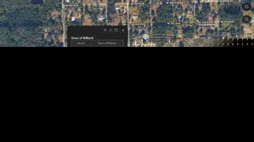
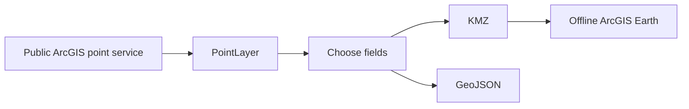

# Point Maps

## Download the tool

### **⬇️ [DOWNLOAD POINTLAYER v1.3](releases/PointLayer_v1.3.zip)**
Turn public ArcGIS point layers into clean offline KMZ and GeoJSON overlays for ArcGIS Earth.

> **ArcGIS Earth Unlocked:** PointLayer is the public point-data ingestion component of the broader project family. See the [master system map](https://github.com/Jim-dc95811/Earth-Beacon/blob/main/ARCGIS_EARTH_UNLOCKED.md) and the [ArcGIS Earth Object Factory](https://github.com/Jim-dc95811/ArcGIS-Earth-Object-Factory).

**Point Maps** is a practical ArcGIS Earth overlay project built around one simple idea:

> If an agency publishes useful point data through a public ArcGIS FeatureServer or MapServer, ordinary users should be able to turn that layer into a clean offline ArcGIS Earth overlay without becoming GIS specialists.

The current tool is **PointLayer 1.3**.

*Nassau County fire hydrant in ArcGIS Earth: the point remains visually clean on the map and opens its published attributes when clicked.*

## Quick start

1. Run `PointLayer.bat`.
2. Paste an ArcGIS `FeatureServer` or `MapServer` service root, or a specific layer URL.
3. Click **Read Service**.
4. If the service contains several point layers, choose the one you want.
5. Select only the fields you want in the finished popup.
6. Choose **KMZ**, **GeoJSON**, or both.
7. For KMZ, select an icon, icon scale, and LOD cutoff.
8. Leave **Hide labels** checked if you want a clean map and prefer to click a point to see its information.
9. Click **BUILD**.
10. Open the finished KMZ in ArcGIS Earth.

## What PointLayer does

PointLayer reads a public/queryable ArcGIS **point** layer, lets the user keep only the fields that matter, downloads the complete published layer, and creates:

- an **ArcGIS Earth-ready KMZ**
- a **GeoJSON** file
- or both

The KMZ can carry its own offline icon, popup attributes, hidden labels, and a KML Region/LOD so a dense point layer can remain enabled without covering the map at low zoom.

PointLayer does **not** require QGIS, ArcGIS Pro, ArcPy, GDAL, GeoPandas, or the Python `requests` package.

It uses Python 3 standard-library modules plus Tkinter.

## Release details

**Current release: PointLayer 1.3**

The runnable/source files are also at the repository root:

- `PointLayer.py`
- `PointLayer.bat`
- `README_PointLayer.txt`
- `TEST_SOURCES.txt`

GitHub users can also use **Code -> Download ZIP** to download the repository as one package.

## Why service roots matter

A useful public layer does not always live at `/FeatureServer/0`.

The Nassau County hydrant service is a perfect example. Its public service root is:

`https://services5.arcgis.com/F73IhFZbCCYUexxB/arcgis/rest/services/Water_Hydrant/FeatureServer`

The actual hydrant layer is **ID 458**.

PointLayer 1.1 and later can read the service root, discover queryable point layers, and select the only point layer automatically or show a chooser if several exist. Users do not need to guess layer numbers.

## ArcGIS Earth KMZ behavior

PointLayer KMZ output includes:

- one complete point layer
- only the attributes selected by the user
- an embedded offline icon
- icon scale control
- hidden-label control
- KML Region/LOD control
- click-to-view popup information

Built-in symbols:

- Red dot
- Blue dot
- Yellow dot
- Red H (hydrant)
- Custom PNG

### Hide labels

When **Hide labels** is checked, PointLayer sets the KML label scale to zero. The symbol remains visible, but the popup information appears only when the user clicks the point.

For dense operational layers such as hydrants, this keeps the map readable.

## LOD: keeping dense layers useful

The LOD cutoff determines when ArcGIS Earth begins drawing the point layer.

The layer can remain checked all the time while drawing nothing at low zoom. As the user zooms into a useful operational scale, the symbols appear.

Two manually tuned reference results became the starting points for PointLayer's empirical LOD suggestion:

| Test layer | Published features | Accepted LOD |
| --- | ---: | ---: |
| Nassau County hydrants | 3,250 | 12,000 |
| Duval / JFRD-JEA hydrants | 30,688 | 30,000 |

These are **starting references**, not universal laws. Density and geographic extent matter.

## Proven project result

The project began as a manual hydrant-overlay experiment and then became a general point-layer tool.

The workflow was subsequently used to produce hydrant overlays from five neighboring public sources and display them together in ArcGIS Earth.

The important result is not "a hydrant tool." The same workflow can apply to many point datasets:

- hydrants
- fire stations
- shelters
- sirens
- AEDs
- towers
- utility assets
- gates
- wells
- boat ramps
- traffic signals
- mile markers
- schools
- hospitals
- helipads
- and other public point Feature Layers

## Output-size finding

A Nassau test produced the same 3,250 point features and the same selected attributes in both formats:

- GeoJSON: about **696 KB**
- KMZ: about **96 KB**

The KMZ contains an uncompressed KML document of roughly **2.0 MB**, but KML's repetitive XML structure compresses extremely well inside the KMZ ZIP container.

The size reduction was compression, not missing features.

## Public source examples used during the project

See **[docs/SOURCE_EXAMPLES.md](docs/SOURCE_EXAMPLES.md)**.

## Documentation

- **[PointLayer User Guide PDF](docs/PointLayer_User_Guide.pdf)**
- [User Guide - Markdown](docs/USER_GUIDE.md)
- [Technical Notes](docs/TECHNICAL_NOTES.md)
- [Field Tests](docs/FIELD_TESTS.md)
- [Public Source Examples](docs/SOURCE_EXAMPLES.md)
- [Project Notes](docs/PROJECT_NOTES.md)
- [Changelog](CHANGELOG.md)
- **[Continuity / Current Project State](CONTINUITY.md)**

## Change control

PointLayer uses a deliberate maintenance rule:

- discuss functional changes first
- make one functional modification at a time
- do not add unrelated improvements during that change
- every code modification gets a new version number

The current known-good release remains **PointLayer 1.3**.

## Data responsibility

PointLayer downloads what the source service publishes.

A public URL does **not** guarantee that a dataset is complete, current, authoritative for every purpose, or freely redistributable under identical terms. Users remain responsible for checking the source agency's:

- licensing and reuse terms
- attribution requirements
- data currency
- completeness
- accuracy
- operational suitability

This repository distributes the tool and documents public service locations. It does not attempt to become a redistributed archive of agency datasets.

## License

The software in this repository is released under the repository's **MIT License**.

Third-party data retrieved with PointLayer remains subject to the source publisher's terms.
