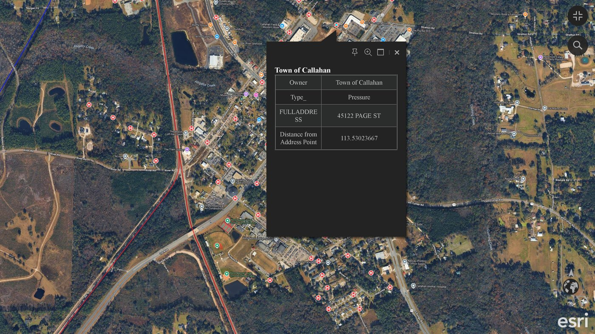
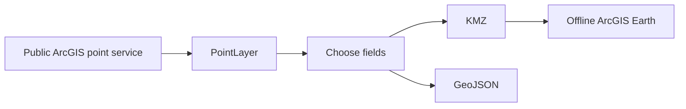

**⭐ EASIEST WAY — [Get all 11 tools from Google Drive](https://drive.google.com/drive/folders/1jsxVTDsYdgJHibhCCeI9I69FsG0qMGgc?usp=sharing)** — no download warnings, the whole series is under 10 MB; open a tool's folder and run its one `.bat`.

# Point Maps

> 🤖 **Using AI assistance?** Have the agent read the [CLAUDE.md](https://github.com/Jim-dc95811/ArcGIS-Earth-Unlocked/blob/main/CLAUDE.md) file first.

## Get everything you need

**1. ⬇️ [ArcGIS Earth](https://www.esri.com/en-us/arcgis/products/arcgis-earth/downloads)** - free 3D globe from Esri (Windows desktop version).

**2. ⬇️ [Python 3](https://www.python.org/downloads/windows/)** - free; install with the default options.

> **First time? Three quick tips**
> 1. **Extract the zip first:** right-click the downloaded zip > **Extract All**, then open the new folder. Double-clicking files while they are still inside the zip does not work.
> 2. **Windows security warning:** Windows may warn about any program downloaded from the internet. Click **More info > Run anyway** (blue "Windows protected your PC" screen) or **Run**. To avoid the warning, right-click the zip > **Properties** > tick **Unblock** > **OK** before extracting.
> 3. **Installing Python:** if the installer shows **"Add python.exe to PATH"**, tick it.

### **⭐ [3. Get PointLayer from Google Drive](https://drive.google.com/drive/folders/1jsxVTDsYdgJHibhCCeI9I69FsG0qMGgc?usp=sharing)**

*Easiest, no download warning: open the Drive folder, open **PointLayer_v2.1**, and run its one `.bat`. Prefer GitHub? Developers can grab the [direct zip](releases/PointLayer_v2.1.zip) - a direct download can trip a Windows antivirus false alarm, which Drive avoids.*
**📖 [User manual](docs/USER_GUIDE.md)**
**🗂️ [What's in the zip - every file explained](assets/pointlayer_whats_in_the_zip_full.png)**
**⭐ EASIEST WAY — [Get all 11 tools from Google Drive](https://drive.google.com/drive/folders/1jsxVTDsYdgJHibhCCeI9I69FsG0qMGgc?usp=sharing)** — no download warnings, the whole series is under 10 MB. Open the folder, open the tool you want, and run its one `.bat`.

*Prefer GitHub, or want the source? Developers can grab the [direct zip of all 11 tools](https://github.com/Jim-dc95811/ArcGIS-Earth-Unlocked/raw/main/downloads/ArcGIS_Earth_Unlocked_All_Tools.zip). Note: a direct download can trip an over-eager Windows antivirus false alarm - the Google Drive folder above avoids it.*

Turn public ArcGIS point layers into clean offline KMZ and GeoJSON overlays for ArcGIS Earth.

*Nassau County hydrants made with PointLayer, offline in ArcGIS Earth around Callahan, Florida. Click any hydrant to see its published details. ▶️ [Watch the video](https://www.youtube.com/watch?v=5Wn14qlC7n4) (YouTube).*

> **ArcGIS Earth Unlocked:** PointLayer is the public point-data ingestion component of the broader project family. See the [master system map](https://github.com/Jim-dc95811/ArcGIS-Earth-Unlocked) and the [ArcGIS Earth Object Factory](https://github.com/Jim-dc95811/ArcGIS-Earth-Object-Factory).

**Point Maps** is a practical ArcGIS Earth overlay project built around one simple idea:

> If an agency publishes useful point data through a public ArcGIS FeatureServer or MapServer, ordinary users should be able to turn that layer into a clean offline ArcGIS Earth overlay without becoming GIS specialists.

The current tool is **PointLayer 2.1** (8 Nov 2026): bigger markers, a ground marker that grows as you zoom in, **Show below (ft)** instead of a pixel LOD, and fixes for bad records, dates and code lists - [what changed](docs/POINTLAYER_V2.1_CHANGES.md).

## Quick start

1. Extract the zip and double-click `PointLayer.bat` (the other item, `System Files`, holds the program - leave it alone).
2. Paste an ArcGIS `FeatureServer` or `MapServer` service root, or a specific layer URL.
3. Click **Read Service**.
4. If the service contains several point layers, choose the one you want.
5. Select only the fields you want in the finished popup.
6. Choose **KMZ**, **GeoJSON**, or both.
7. For KMZ, select an icon, icon scale, the ground marker size and **Show below (ft)**.
8. Leave **Hide labels** checked if you want a clean map and prefer to click a point to see its information.
9. Click **BUILD**.
10. Open the finished KMZ in ArcGIS Earth.

## What PointLayer does

PointLayer reads a public/queryable ArcGIS **point** layer, lets the user keep only the fields that matter, downloads the complete published layer, and creates:

- an **ArcGIS Earth-ready KMZ**
- a **GeoJSON** file
- or both

The KMZ can carry its own offline icon, popup attributes, hidden labels, and a KML Region/LOD so a dense point layer can remain enabled without covering the map at low zoom.

PointLayer does **not** require QGIS, ArcGIS Pro, ArcPy, GDAL, GeoPandas, or the Python `requests` package.

It uses Python 3 standard-library modules plus Tkinter.

## Release details

**Current release: PointLayer 2.1** (2026-11-08) - re-hardening plus bigger markers, a ground marker and Show below (ft); see [docs/POINTLAYER_V2.1_CHANGES.md](docs/POINTLAYER_V2.1_CHANGES.md). `PointLayer_v2.1.zip` SHA-256 `e58e7efd49d2ccfa03f4b0df22a960959cbbe4625023ec287f06e3afef19d82f`, `PointLayer.py` `4d565ed2d330b7baef7ad06a6b591786851d860ff3b537eb87737745271bd22e`. **PointLayer 2.0** (2026-11-08) - part of the [2.0 Reference](https://github.com/Jim-dc95811/ArcGIS-Earth-Unlocked/blob/main/REFERENCE_2.0.md): program = 1.4 with only the version text changed. **PointLayer 1.4.2** (2026-11-08) - Ready to Fly: `PointLayer.bat` finds Python or installs it for you (no admin) before starting; the program is the same 1.4. **PointLayer 1.4.1** (2026-11-06) - one obvious file: the zip now holds a `PointLayer_v1.4.1` folder with `PointLayer.bat` and `System Files` (the program). The program is the 1.4 program, unchanged. `PointLayer_v1.4.1.zip` SHA-256 `89c9b5f8b489b8711432fe142988b40f766ae72548ec55aea30703251d5d86fd`.

**PointLayer 1.4** (2026-11-01) - a hardening release: every published point is checked off and any the service fails to return are reported; one bad record can no longer spoil the KMZ; single-point layers can appear; existing files are protected. Normal output is identical to 1.3. See [docs/POINTLAYER_V1.4_CHANGES.md](docs/POINTLAYER_V1.4_CHANGES.md).

The source files are also in the repository, laid out like the download:

- `PointLayer.bat`
- `System Files/PointLayer.py`

Plus two notes that are not in the download: `README_PointLayer.txt` (quick notes) and `TEST_SOURCES.txt` (the services PointLayer was tested with).

GitHub users can also use **Code -> Download ZIP** to download the repository as one package.

## Why service roots matter

A useful public layer does not always live at `/FeatureServer/0`.

The Nassau County hydrant service is a perfect example. Its public service root is:

`https://services5.arcgis.com/F73IhFZbCCYUexxB/arcgis/rest/services/Water_Hydrant/FeatureServer`

The actual hydrant layer is **ID 458**.

PointLayer 1.1 and later can read the service root, discover queryable point layers, and select the only point layer automatically or show a chooser if several exist. Users do not need to guess layer numbers.

## ArcGIS Earth KMZ behavior

PointLayer KMZ output includes:

- one complete point layer
- only the attributes selected by the user
- an embedded offline icon
- icon scale control
- hidden-label control
- KML Region/LOD control
- click-to-view popup information

Built-in symbols:

- Red dot
- Blue dot
- Yellow dot
- Red H (hydrant)
- Custom PNG

### Hide labels

When **Hide labels** is checked, PointLayer sets the KML label scale to zero. The symbol remains visible, but the popup information appears only when the user clicks the point.

For dense operational layers such as hydrants, this keeps the map readable.

## Show below: keeping dense layers useful

Since 2.1 you set **Show below (ft)** - the eye alt (as ArcGIS Earth shows it) below which the points draw. PointLayer turns it into the KML Region/LOD number using the size of the layer, so a small layer and a whole county both behave as typed. The suggestion after Read Service reproduces the accepted references below for county-size layers and is at least 10,000 ft.

The layer can remain checked all the time while drawing nothing at low zoom. As the user zooms into a useful operational scale, the symbols appear.

Two manually tuned reference results (pixel LOD, used up to 2.0) are the anchors for the suggestion:

| Test layer | Published features | Accepted LOD |
| --- | ---: | ---: |
| Nassau County hydrants | 3,250 | 12,000 |
| Duval / JFRD-JEA hydrants | 30,688 | 30,000 |

These are **starting references**, not universal laws. Density and geographic extent matter.

## Proven project result

The project began as a manual hydrant-overlay experiment and then became a general point-layer tool.

The workflow was subsequently used to produce hydrant overlays from five neighboring public sources and display them together in ArcGIS Earth.

The important result is not "a hydrant tool." The same workflow can apply to many point datasets:

- hydrants
- fire stations
- shelters
- sirens
- AEDs
- towers
- utility assets
- gates
- wells
- boat ramps
- traffic signals
- mile markers
- schools
- hospitals
- helipads
- and other public point Feature Layers

## Output-size finding

A Nassau test produced the same 3,250 point features and the same selected attributes in both formats:

- GeoJSON: about **696 KB**
- KMZ: about **96 KB**

The KMZ contains an uncompressed KML document of roughly **2.0 MB**, but KML's repetitive XML structure compresses extremely well inside the KMZ ZIP container.

The size reduction was compression, not missing features.

## Public source examples used during the project

See **[docs/SOURCE_EXAMPLES.md](docs/SOURCE_EXAMPLES.md)**.

## Documentation

- **[PointLayer User Guide PDF](docs/PointLayer_User_Guide.pdf)**
- [User Guide - Markdown](docs/USER_GUIDE.md)
- [Technical Notes](docs/TECHNICAL_NOTES.md)
- [Field Tests](docs/FIELD_TESTS.md)
- [Public Source Examples](docs/SOURCE_EXAMPLES.md)
- [Project Notes](docs/PROJECT_NOTES.md)
- [1.4 change document](docs/POINTLAYER_V1.4_CHANGES.md)
- [Changelog](CHANGELOG.md)
- **[Continuity / Current Project State](CONTINUITY.md)**

## Change control

PointLayer uses a deliberate maintenance rule:

- discuss functional changes first
- make one functional modification at a time
- do not add unrelated improvements during that change
- every code modification gets a new version number

The current known-good release is **PointLayer 2.1**. Earlier packages are kept in `archive/`.

## Human-AI engineering collaboration

PointLayer was conceived, directed and field-tested by **Jim Gaddy**, working with **OpenAI's ChatGPT** and **Anthropic's Claude** as AI coding and documentation partners. Jim supplied the public-safety use case, the real county services (Nassau and Duval hydrants) and the ArcGIS Earth acceptance tests and LOD choices. ChatGPT helped build PointLayer 1.0-1.3. Claude built the 1.4 hardening release (completeness checks, safe writes, clean XML) with its mock-service test rig, the user guide and its PDF, and the 'What's in the zip' sheet.

This acknowledgment is not a claim of OpenAI or Anthropic sponsorship or endorsement.

## Data responsibility

PointLayer downloads what the source service publishes.

A public URL does **not** guarantee that a dataset is complete, current, authoritative for every purpose, or freely redistributable under identical terms. Users remain responsible for checking the source agency's:

- licensing and reuse terms
- attribution requirements
- data currency
- completeness
- accuracy
- operational suitability

This repository distributes the tool and documents public service locations. It does not attempt to become a redistributed archive of agency datasets.

## License

The software in this repository is released under the repository's **MIT License**.

Third-party data retrieved with PointLayer remains subject to the source publisher's terms.
