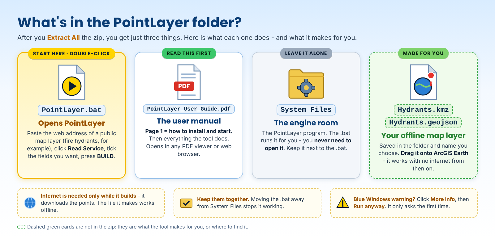

# PointLayer 2.1 User Guide

<!-- install-blurb:start -->
> ### Installing PointLayer - read this first
>
> 1. **Open the tool's folder.** Easiest is **Google Drive** (the link at the top of the project page): the folder is already unpacked - just open it, nothing to extract. If instead you downloaded the **zip** from GitHub, right-click it > **Extract All** first, then open the new folder. (Double-clicking files while they are still inside a zip does not work.)
> 2. **Double-click `PointLayer.bat`** - the only .bat in the folder. This manual sits right next to it. The **System Files** folder holds the program - leave it alone.
> 3. **Blue "Windows protected your PC" box?** Click **More info**, then **Run anyway**. It only asks the first time. (Or, before extracting: right-click the zip > **Properties** > tick **Unblock** > **OK**.)
> 4. **Python - nothing to install by hand.** If Python is missing, the window asks **Install Python now? [Y/N]**: type **Y** and press Enter. It installs just for you (no admin needed). On an older PC this can take several minutes and Windows Defender may make the PC look frozen - **do not close the window**.
> 5. An internet connection (it downloads public map layers).
> 6. To see the result you need **ArcGIS Earth** (free from Esri: https://www.esri.com/en-us/arcgis/products/arcgis-earth/downloads).
>
> Something stops it? The window says what to do in plain words, and keeps a log in `System Files\Ready_To_Fly_log.txt`. On a work computer that blocks installs, ask IT to install Python 3 from python.org.
<!-- install-blurb:end -->

A printable copy of this guide is available as [PointLayer_User_Guide.pdf](PointLayer_User_Guide.pdf).

## Purpose

PointLayer converts a public/queryable ArcGIS point Feature Layer into one complete offline point overlay for ArcGIS Earth.

The program is intentionally narrow: it handles **point geometry**. It does not attempt to turn every GIS format or geometry type into one universal converter.

## Requirements

- Windows
- Python 3 with Tkinter
- Internet access while reading/downloading the public service
- ArcGIS Earth for the intended KMZ viewing workflow

No QGIS, ArcGIS Pro, ArcPy, GDAL, GeoPandas, or Python `requests` package is required.

## Start the program

1. Download [`PointLayer_v2.1.zip`](../releases/PointLayer_v2.1.zip) and extract it. You get a `PointLayer_v2.1` folder holding just `PointLayer.bat`, this guide as a PDF (`PointLayer_User_Guide.pdf`) and `System Files`.
2. Python 3: nothing to install by hand. Since this version the .bat does it for you: if Python is missing it asks **Install Python now? [Y/N]** - answer **Y** (installs just for you, no admin; on an older PC it can take several minutes - don't close the window).
3. Double-click `PointLayer.bat`. It uses the `py` launcher if present, otherwise `python`. Leave `System Files` alone - it holds the program.

The window title shows **PointLayer 2.1**. What changed: [POINTLAYER_V2.1_CHANGES.md](POINTLAYER_V2.1_CHANGES.md).

## What's in the zip

## Step 1 - Paste a public ArcGIS service

PointLayer accepts either (a link copied from the browser with `?f=pjson` or `/query` on the end works too):

- `/FeatureServer`
- `/FeatureServer/<layer id>`
- `/MapServer`
- `/MapServer/<layer id>`

Click **Read Service**.

If the root has one queryable point layer, it is selected automatically. If several point layers are available, PointLayer presents a chooser: pick the layer and click **Use Selected Layer**.

When the layer has been read, the status line reports the number of points and a suggested **Show below** height (see Step 4), and the base name is filled in from the layer name.

## Step 2 - Choose fields

The field table shows the service fields, aliases, and field types.

Controls:

- **Recommended** - selects fields whose names/aliases look operationally useful.
- **All** - selects all fields.
- **None** - clears the selection.
- Click an individual row to toggle it. A check mark in the **Keep** column means the field will be written.

The finished KMZ popup contains only the fields you select.

OID fields are normally unnecessary.

Do not assume a field named Latitude or Longitude is actually decimal geographic coordinates. Some public layers store projected X/Y values or legacy values in fields with misleading names. PointLayer uses the service geometry and requests output geometry in EPSG:4326.

## Step 3 - Choose output

Choose the output folder (default: your Desktop; the folder must already exist) and the base name (filled in from the layer name; you can change it).

Output choices (tick one or both):

- **KMZ** (ticked by default)
- **GeoJSON**

If a file with that name already exists, PointLayer asks before replacing it.

### KMZ

Use KMZ when the primary goal is ArcGIS Earth.

KMZ provides:

- embedded icon
- icon scale
- hidden labels
- KML Region/LOD
- clickable popup attributes

### GeoJSON

GeoJSON preserves the selected attributes and point geometry but does not carry the same Earth-specific presentation.

## Step 4 - Choose KMZ style

Built-in symbols (default **Red dot**):

- Red dot
- Blue dot
- Yellow dot
- Red H (hydrant)

To use your own icon, choose **Custom PNG** in the Symbol list, then click **Browse PNG**. The file must be a real PNG image; a renamed JPEG is rejected. The icon is embedded in the KMZ, so the layer stays self-contained offline.

### Scale

Default `1.0` (was 0.50 up to 2.0). Larger numbers draw bigger icons. ArcGIS Earth draws an icon at a fixed size on the screen: it does not grow as you zoom in - that is what the ground marker is for.

### Ground marker

**Disc on the ground**, on by default, **Size (m)** 4. Each point also gets a disc of that many metres on the ground, in the symbol's colour. Unlike the icon it grows as you zoom in (like a QGIS symbol sized in map units), so up close you see exactly where the hydrant stands on the imagery. Click it for the same popup. Untick it for icons only.

### Hide labels

Checked by default. Checked means the symbol is visible but text is not drawn beside every point.

Click the point to see its popup information.

This is normally the useful setting for dense operational layers.

### Show below (ft)

The eye alt in feet - as ArcGIS Earth shows it at the bottom of the screen - below which the points draw. 0 or blank = always show. (Up to 2.0 this box was the pixel "LOD cutoff"; PointLayer now works that number out from the feet and the size of the layer.)

A high-density layer should not necessarily appear while the user is looking at an entire county. Keeping the layer enabled but invisible until a useful zoom level prevents a wall of overlapping symbols.

After Read Service, PointLayer suggests a height from the number of points and the size of the layer - at least 10,000 ft. For county-size layers it reproduces these proven pixel references:

- Nassau County hydrants: 3,250 published point features -> LOD 12,000
- Duval / JFRD-JEA hydrants: 30,688 published point features -> LOD 30,000

Lower the feet if the symbols appear too early (too high up). Raise them if they appear too late. In a tilted view the points disappear a little sooner than looking straight down.

## Step 5 - BUILD

Click **BUILD**. It becomes available once a service has been read.

PointLayer:

1. requests the complete Object ID list
2. downloads feature records in safe batches
3. automatically splits a failing batch into smaller batches when appropriate
4. requests geometry in EPSG:4326
5. keeps only selected attributes
6. checks that every listed point was returned, asks once more for any missing, and warns if some are still missing
7. calculates the downloaded point extent
8. writes the selected output format(s), asking first if a file of that name already exists

The completion message reads `N of M published points written`. It also reports any points the service did not return, and any records published without a location.

## Open in ArcGIS Earth

Double-click the KMZ or add it through ArcGIS Earth.

With labels hidden:

- symbols remain clean
- the layer can stay checked
- LOD delays drawing until useful zoom
- click a symbol to see selected information

## File-size behavior

In one Nassau test, the same 3,250 features and selected fields produced:

- GeoJSON: 695,722 bytes
- KMZ: 96,350 bytes

The KMZ's internal uncompressed KML was roughly 2.0 MB. ZIP compression reduced it dramatically because XML repeats the same tags and field names thousands of times.

No hydrants were removed to achieve the smaller file.

## Troubleshooting

### The service says layer 0 does not exist

Do not add `/0` just because many ArcGIS examples use layer zero.

Paste the service root and let PointLayer discover the actual point layer.

Nassau's hydrant layer, for example, is layer **458**.

### BUILD button is off-screen

Scroll the upper part of the window. BUILD, the status line and the progress bar stay fixed at the bottom.

### Too many symbols appear at once

Lower **Show below (ft)**.

### Symbols appear too late (only when almost on top of them)

Raise **Show below (ft)**.

### The icon looks tiny up close

An icon keeps the same size on the screen. Keep **Disc on the ground** ticked - the disc grows as you zoom in. Raise **Scale** for a bigger icon.

### Popup is cluttered

Rebuild and select fewer fields. The popup shows only the fields you selected.

### "The server did not send map data"

The link leads to a login page or something that is not an ArcGIS REST service. Use the public `/FeatureServer` or `/MapServer` link.

### "Output folder does not exist"

PointLayer does not create folders. Choose an existing folder with **Browse**.

### "... is not a PNG image"

The custom icon must be a PNG. Convert it, or pick one of the built-in symbols.

### "WARNING: ... published features were not returned by the service"

The service listed those points but did not send them, even when asked twice. The layer was written without them. Try again later, and check with the publisher if it persists.

### A one-point or very small layer does not appear

Since 2.1 Show below (ft) takes the layer's size into account. If it still appears too late, raise the feet (or set 0 = always).

### Records "had no location"

The service sent those records without a usable location (blank or "NaN"). They are counted and skipped; every other point is written.

### A "Latitude" or "Longitude" field looks wrong

The public service may be storing projected coordinates or another convention in those attributes. PointLayer places points using the layer geometry requested in EPSG:4326, not by trusting attribute names.

## Data responsibility

The tool downloads the records that the source service publishes. A published feature count is not automatically proof of the real-world total number of assets.

For example, "3,250 features downloaded from Nassau's hydrant layer" is precise. "Nassau County has exactly 3,250 hydrants" would require a separate completeness claim from the data owner.

Always check source-agency terms, currency, completeness, and operational suitability.
